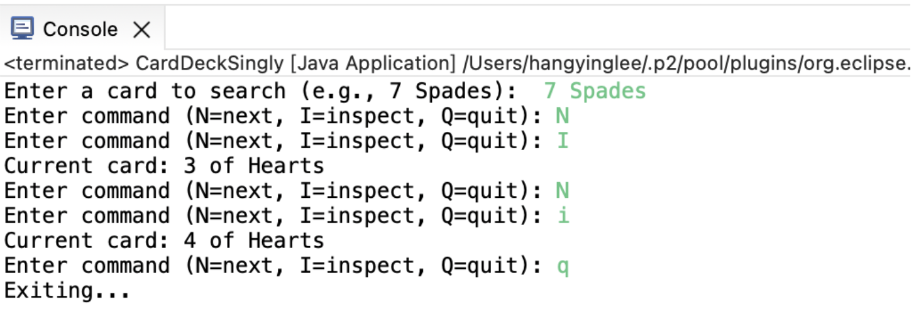

# Linked List Card Navigator

A Java console application that uses custom singly and doubly linked lists to navigate a standard 52-card deck. Developed as a CS 211 course project.

## Features

- Builds a 52-card deck using custom node classes.
- Supports forward traversal with a singly linked list.
- Supports forward and backward traversal with a doubly linked list.
- Displays the current card and checks whether it matches a user-selected target.
- Handles navigation at the beginning and end of the deck.

## Implementation

- `Card`: stores a card's rank and suit.
- `Node` and `SinglyLinkedDeck`: implement the singly linked version.
- `DoubleNode` and `DoublyLinkedDeck`: implement the doubly linked version using next and previous references.
- `CardDeckSingly` and `CardDeckDoubly`: provide interactive console interfaces.

The linked lists are implemented manually rather than using Java's built-in LinkedList.

## How to Run

Install a Java Development Kit (JDK). From the repository root, compile the source files:

```bash
javac -d out src/cs211_Assignment8_Linked_Lists/*.java
```

Run the singly linked version:

```bash
java -cp out cs211_Assignment8_Linked_Lists.CardDeckSingly
```

Or run the doubly linked version:

```bash
java -cp out cs211_Assignment8_Linked_Lists.CardDeckDoubly
```

## Controls

At startup, enter a target card such as `7 Spades`.

| Command | Action | Version |
|---------|--------|---------|
| `N` or `>` | Move to the next card | Both |
| `B` or `<` | Move to the previous card | Doubly linked |
| `I` or `VIEW` | Display the current card and check for a match | Both |
| `Q` | Quit | Both |

Navigation starts at the 2 of Hearts. Moving does not automatically display the card; use `I` to inspect it.

## Example

Enter `3 Hearts` as the target, then enter these commands one at a time:

```text
I
N
I
Q
```

The first inspection displays `2 of Hearts`. After moving forward, the second inspection displays `3 of Hearts` and `Card FOUND!`.

## Technologies

## Demo / Screenshots

### Singly Linked List — Console Demo

The application allows users to navigate a 52-card deck,
inspect the current card, and search for a target card.



Java, custom singly and doubly linked lists, and console input with Scanner.
